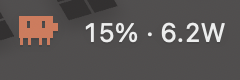
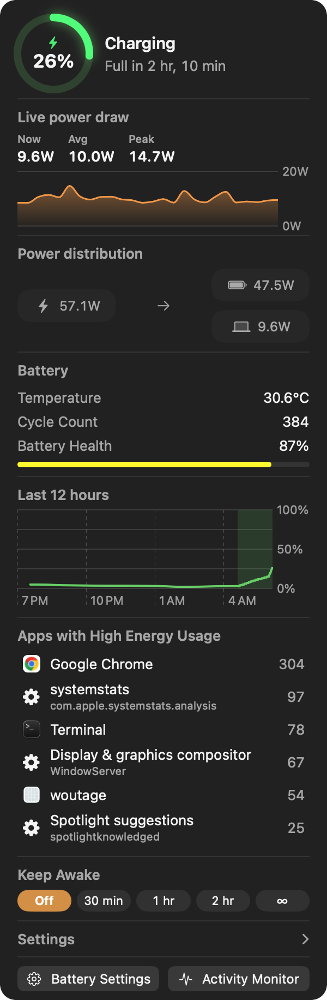
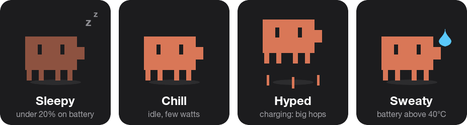

<p align="center">
  
</p>

<p align="center">
  A macOS menu bar app that shows how many watts your Mac is drawing, where
  that power is going, and which apps are draining the battery. With a small
  battery-shaped critter that lives in your menu bar.
</p>

<p align="center">
  
</p>

It runs as a normal user app, with no privileged helper and no root.

## What it shows



- **Menu bar**: the sprite, plus battery % and live watts, updated every
  second. Pick `% + W`, `%`, `W` or icon only.
- **Battery ring**: charge level, charging state and time to full or empty.
  It glows while charging and turns orange, then red, as you run low.
- **Live power draw**: what the whole Mac is using, charted over the last
  five minutes, with now / average / peak.
- **Power distribution**: where the watts go. On battery it's
  `battery → laptop`. On the charger it splits into what the charger supplies,
  what the laptop uses, and what goes into the battery.
- **Battery**: temperature (click to switch °C / °F), cycle count, and
  health with a capacity bar.
- **Last 12 hours**: charge level history, with plugged-in stretches shaded.
- **Apps with high energy usage**: the top energy users, with icons. Click
  an app to bring it to the front.
- **Keep Awake**: stop the Mac and screen from sleeping for 30 min, 1 hr,
  2 hr, or until you turn it off.
- **Settings**: low battery alerts, launch at login, and what the menu bar
  shows.

System processes get plain-English names, so the list says
`Display & graphics compositor` rather than `WindowServer`, with the raw
process name underneath.

<br clear="right">

## The sprite has moods

<p align="center">
  
</p>

It wanders around its spot in the menu bar, and how it moves depends on the
Mac:

- **Busier** the more power the Mac draws: idle means long naps, a heavy
  load means it scurries.
- **Big hops** while charging.
- **Sleepy** under 20% on battery: it fades out and barely moves.
- **Sweaty** when the battery is above 40°C.

## Low battery alerts

Choose any of 5, 10, 15, 20, 30 or 50% (20% and 10% are on by default). You
get one notification per level each time the battery runs down, and they
reset when you plug in. If the battery drops past several levels at once, for
example while the Mac was asleep, you only get one alert for the lowest.

## Install

```sh
./build.sh
```

This compiles, ad-hoc signs, installs into `/Applications`, and launches.
It needs the Xcode command line tools and macOS 13 or later. Liquid Glass
styling kicks in on macOS 26.

## How it works

Everything comes from APIs a normal user process can reach:

| Value | Source |
| --- | --- |
| Live system power, charger input | SMC sensors `PSTR` and `PDTR`, read once a second |
| Battery level, charging state, time remaining | `IOPSCopyPowerSourcesInfo` |
| Cycle count, temperature | `AppleSmartBattery` IOKit registry |
| Battery health | `system_profiler SPPowerDataType` |
| Charge history | `systemstats_get_battery_charge_graph` |
| Per-app energy impact | `systemstats_get_top_coalitions` |
| Keep Awake | `IOPMAssertionCreateWithName` |
| Launch at login | `SMAppService` |

**Power.** The battery gas gauge in the IOKit registry can hold the same
reading for 30 seconds or more, which is too slow for a live readout. So
woutage reads the SMC (the Mac's power-management controller) directly. That
takes no root, and its sensors update about once a second. `PSTR` is what the
whole Mac draws, and `PDTR` is what arrives from the charger. Whatever the
charger doesn't cover comes out of the battery, so battery power is the
difference. The menu bar, the live chart and the distribution view all read
those same values, so they always agree. If the SMC can't be opened, woutage
falls back to the gas gauge.

**Per-app energy.** This uses the same private `libsystemstats` call Activity
Monitor relies on, loaded with `dlopen`. It reports *coalitions*, the
kernel's own grouping of a process tree, so an app's helper processes are
already counted against the parent app rather than listed separately.

**The sprite.** The button gets a fixed, transparent placeholder image, and
the sprite is a separate layer drawn on top. Each frame only that layer
moves, snapped to whole pixels. That way the status item never has to re-lay
out, which is what made earlier versions flicker.

## Prior art

The power distribution layout follows
[BatFi](https://github.com/rurza/BatFi) by Adam Różyński, which is a far more
capable app and worth buying if you want charge limiting. BatFi reads the SMC
through a privileged helper because it also writes to it to control charging.
woutage only reads, so it doesn't need one.
